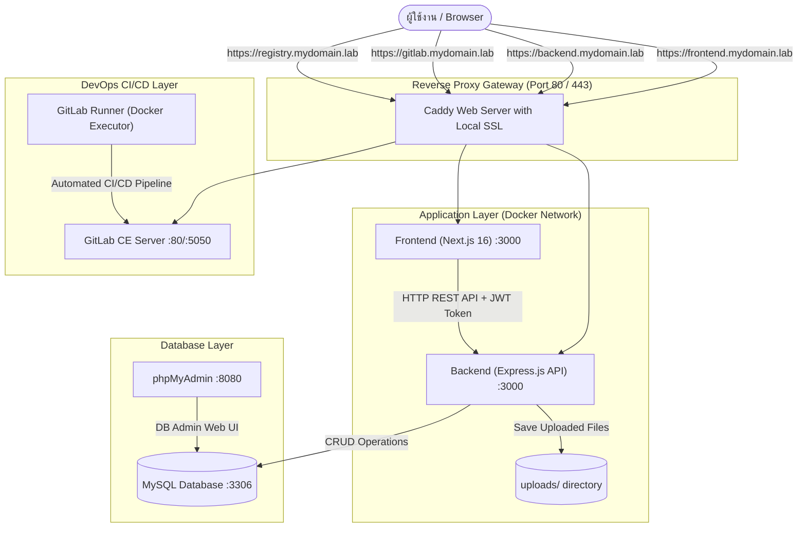

# คู่มือขั้นตอนการพัฒนาโปรเจกต์ Fullstack DevOps & Web Application แบบสมบูรณ์ (100% Complete Code)

คู่มือนี้จัดทำขึ้นอย่างละเอียดเป็นขั้นตอน (Step-by-Step) เพื่อใช้สำหรับเป็นแนวทางฝึกซ้อมทำโปรเจกต์ และสามารถนำเนื้อหานี้ไปพัฒนาเป็นเว็บฝึกอบรม/เว็บแสดงขั้นตอนได้ทันที โดยรวบรวมคำอธิบาย โครงสร้างโฟลเดอร์ คำสั่ง Command-line และ **Source Code ฉบับเต็ม 100% ทุกไฟล์โดยไม่ตัดทอน**

---

## สารบัญขั้นตอนการพัฒนา

1. [ภาพรวมสถาปัตยกรรมและโครงสร้างโปรเจกต์ (Overview & Architecture)](#1-ภาพรวมสถาปัตยกรรมและโครงสร้างโปรเจกต์)
2. [การเตรียมสภาพแวดล้อมและโดเมนจำลอง (Environment & Domain Setup)](#2-การเตรียมสภาพแวดล้อมและโดเมนจำลอง)
3. [ขั้นตอนที่ 1: พัฒนา Backend API (Express.js + MySQL + JWT)](#3-ขั้นตอนที่-1-พัฒนา-backend-api)
   - [1.1 สร้างไฟล์ package.json (Backend)](#31-สร้างไฟล์-packagejson-backend)
   - [1.2 ระบบเชื่อมต่อฐานข้อมูลและ Auto Migration (config/db.js)](#32-ระบบเชื่อมต่อฐานข้อมูลและ-auto-migration-configdbjs)
   - [1.3 ระบบ Middleware ตรวจสอบสิทธิ์ (middlewares/auth.middleware.js)](#33-ระบบ-middleware-ตรวจสอบสิทธิ์-middlewaresauthmiddlewarejs)
   - [1.4 Routing ระบบ Authentication (routes/auth.routes.js)](#34-routing-ระบบ-authentication-routesauthroutesjs)
   - [1.5 Routing ระบบจัดการผู้ใช้งาน CRUD (routes/user.routes.js)](#35-routing-ระบบจัดการผู้ใช้งาน-crud-routesuserroutesjs)
   - [1.6 Entry Point เซิร์ฟเวอร์และระบบอัปโหลดไฟล์ (index.js)](#36-entry-point-เซิร์ฟเวอร์และระบบอัปโหลดไฟล์-indexjs)
4. [ขั้นตอนที่ 2: การสร้างชุดทดสอบอัตโนมัติ (Automated Testing: Unit, Integration, E2E)](#4-ขั้นตอนที่-2-การสร้างชุดทดสอบอัตโนมัติ)
   - [2.1 สร้างไฟล์ชุดทดสอบ (test.js)](#41-สร้างไฟล์ชุดทดสอบ-testjs)
   - [2.2 การรันชุดทดสอบ](#42-การรันชุดทดสอบ)
5. [ขั้นตอนที่ 3: พัฒนา Frontend Web Application (Next.js 16 + React 19)](#5-ขั้นตอนที่-3-พัฒนา-frontend-web-application)
   - [3.1 โครงสร้างโฟลเดอร์และการตั้งค่า Frontend (frontend/package.json)](#51-โครงสร้างโฟลเดอร์และการตั้งค่า-frontend-frontendpackagejson)
   - [3.2 การตั้งค่า Next.js และ Linter](#52-การตั้งค่า-nextjs-และ-linter)
   - [3.3 Root Layout (frontend/src/app/layout.js)](#53-root-layout-frontendsrcapplayoutjs)
   - [3.4 คอมโพเนนต์หน้าแรกสำรอง (frontend/src/app/Home.js)](#54-คอมโพเนนต์หน้าแรกสำรอง-frontendsrcapphomejs)
   - [3.5 หน้าระบบหลัก Client UI & State Management (frontend/src/app/page.js)](#55-หน้าระบบหลัก-client-ui--state-management-frontendsrcapppagejs)
6. [ขั้นตอนที่ 4: การจัดทำ Containerization (Docker & Docker Compose)](#6-ขั้นตอนที่-4-การจัดทำ-containerization)
   - [4.1 Backend Dockerfile และ .dockerignore](#61-backend-dockerfile-และ-dockerignore)
   - [4.2 Frontend Dockerfile และ frontend/.dockerignore](#62-frontend-dockerfile-และ-frontenddockerignore)
   - [4.3 รวมบริการทั้งหมดด้วย docker-compose.yml](#63-รวมบริการทั้งหมดด้วย-docker-composeyml)
7. [ขั้นตอนที่ 5: การตั้งค่า Reverse Proxy & Local HTTPS ด้วย Caddy](#7-ขั้นตอนที่-5-การตั้งค่า-reverse-proxy--local-https-ด้วย-caddy)
   - [5.1 สร้างไฟล์คอนฟิก Caddyfile](#51-สร้างไฟล์คอนฟิก-caddyfile)
8. [ขั้นตอนที่ 6: การตั้งค่า Version Control และ CI/CD Pipeline (GitLab)](#8-ขั้นตอนที่-6-การตั้งค่า-version-control-และ-cicd-pipeline-gitlab)
   - [6.1 การตั้งค่า .gitignore](#61-การตั้งค่า-gitignore)
   - [6.2 Pipeline อัตโนมัติ (.gitlab-ci.yml)](#62-pipeline-อัตโนมัติ-gitlab-ciyml)
   - [6.3 การตั้งค่า GitLab Runner และ Push โค้ด](#63-การตั้งค่า-gitlab-runner-และ-push-โค้ด)
9. [ขั้นตอนที่ 7: การเปิดระบบและทดสอบการทำงานภาพรวม (Deployment & Verification)](#9-ขั้นตอนที่-7-การเปิดระบบและทดสอบการทำงานภาพรวม)
10. [สรุปตารางโครงสร้างไฟล์ทั้งหมด (Complete File Map)](#10-สรุปตารางโครงสร้างไฟล์ทั้งหมด)

---

## 1. ภาพรวมสถาปัตยกรรมและโครงสร้างโปรเจกต์

ระบบนี้เป็นระบบ Fullstack Web Application พร้อม DevOps Pipeline ประกอบด้วย:
1. **Frontend:** พัฒนาด้วย Next.js (App Router, React 19) รองรับ Responsive UI, Authentication State, Role-based Rendering (Admin vs Readonly), การค้นหา/กรองข้อมูลแบบ Realtime, และการอัปโหลดไฟล์
2. **Backend API:** พัฒนาด้วย Node.js + Express.js ให้บริการ RESTful API แบ่งสิทธิ์ด้วย JWT Token, ตรวจสอบ Payload, รองรับ Multipart File Upload ด้วย Multer และ Error Handling Middleware
3. **Database:** MySQL ฐานข้อมูลหลัก มีฟังก์ชัน Auto Initialization (สร้างตาราง `users` และ `files` พร้อม Seed ข้อมูลเริ่มต้นทันทีที่รัน API)
4. **Database GUI:** phpMyAdmin สำหรับจัดการฐานข้อมูลผ่าน Web Browser
5. **Reverse Proxy:** Caddy Server จัดการ Routing โดเมนจำลอง 4 โดเมน พร้อมรองรับ SSL/HTTPS อัตโนมัติ (`local_certs`)
6. **DevOps & CI/CD:** GitLab Server (Self-hosted) + GitLab Runner ดำเนินการ Test -> Build -> Push -> Deploy อัตโนมัติ



---

## 2. การเตรียมสภาพแวดล้อมและโดเมนจำลอง

### 2.1 ติดตั้งเครื่องมือพื้นฐาน (สำหรับ Linux/Ubuntu)
```bash
# 1. ติดตั้ง Docker Engine และ Docker Compose Plugin
curl -fsSL https://get.docker.com | sudo sh
sudo usermod -aG docker $USER && newgrp docker

# 2. ติดตั้ง Node.js 20 LTS (หากต้องการรัน/ทดสอบแบบ Local โดยไม่ผ่าน Docker)
curl -fsSL https://deb.nodesource.com/setup_20.x | sudo -E bash -
sudo apt-get install -y nodejs
```

### 2.2 การตั้งค่า Local Domain Resolution (Hosts File)
เพื่อให้เครื่องเบราว์เซอร์สามารถเปิดเข้าใช้งานผ่านชื่อโดเมนจำลอง (`frontend.mydomain.lab`, `backend.mydomain.lab`, `gitlab.mydomain.lab`, `registry.mydomain.lab`) ที่ Caddy จัดการได้ **จำเป็นต้องเพิ่มบรรทัดแมปโดเมนเข้ากับ IP 127.0.0.1 ในไฟล์ hosts ของระบบปฏิบัติการก่อน:**

#### วิธีที่ 1: สำหรับ Ubuntu / Linux / macOS
เปิด Terminal แล้วรันคำสั่งเพิ่มบรรทัดลงใน `/etc/hosts` ด้วยสิทธิ์ `sudo`:
```bash
echo "127.0.0.1 backend.mydomain.lab frontend.mydomain.lab gitlab.mydomain.lab registry.mydomain.lab" | sudo tee -a /etc/hosts
```
*หรือเปิดแก้ไขด้วย nano:*
```bash
sudo nano /etc/hosts
```
แล้ววางบรรทัดนี้ไว้ด้านล่างสุด แล้วกด `Ctrl + O` (Save) และ `Ctrl + X` (Exit):
```text
127.0.0.1 backend.mydomain.lab frontend.mydomain.lab gitlab.mydomain.lab registry.mydomain.lab
```

#### วิธีที่ 2: สำหรับ Windows (10 / 11)
ไฟล์ hosts ของ Windows จะอยู่ที่พาธ: `C:\Windows\System32\drivers\etc\hosts`
1. กดปุ่ม `Start` ค้นหาโปรแกรม **Notepad** (หรือ VS Code)
2. **คลิกขวาที่ Notepad แล้วเลือก "Run as administrator" (เรียกใช้ในฐานะผู้ดูแลระบบ)** *(สำคัญมาก มิฉะนั้นจะเซฟไฟล์ไม่ได้)*
3. ไปที่เมนู `File` -> `Open...` 
4. พิมพ์หรือเปิดไปที่โฟลเดอร์: `C:\Windows\System32\drivers\etc` (หากมองไม่เห็นไฟล์ ให้เปลี่ยนตัวเลือกมุมขวาล่างจาก `Text Documents (*.txt)` เป็น `All Files (*.*)`)
5. เลือกเปิดไฟล์ชื่อ `hosts`
6. เลื่อนลงไปบรรทัดล่างสุด แล้วเพิ่มบรรทัดนี้ลงไป:
```text
127.0.0.1 backend.mydomain.lab frontend.mydomain.lab gitlab.mydomain.lab registry.mydomain.lab
```
7. กด `Ctrl + S` เพื่อบันทึกไฟล์

*(หรือวิธีเปิดผ่าน PowerShell ในโหมด Administrator):*
```powershell
Add-Content -Path "C:\Windows\System32\drivers\etc\hosts" -Value "`n127.0.0.1 backend.mydomain.lab frontend.mydomain.lab gitlab.mydomain.lab registry.mydomain.lab"
```

---

## 3. ขั้นตอนที่ 1: พัฒนา Backend API

สร้างไดเรกทอรีโปรเจกต์หลักและสร้างโฟลเดอร์ย่อย:
```bash
mkdir -p api/config api/middlewares api/routes api/uploads
cd api
```

### 3.1 สร้างไฟล์ package.json (Backend)
ไฟล์ `package.json` อยู่ที่ตำแหน่งรากของโปรเจกต์ (`/package.json`) ใช้สำหรับจัดการ dependencies ของ Backend และ Scripts ต่างๆ

```json
{
  "scripts": {
    "start": "node index.js",
    "test": "node test.js"
  },
  "dependencies": {
    "cors": "^2.8.6",
    "express": "^4.19.2",
    "jsonwebtoken": "^9.0.2",
    "multer": "^1.4.5-lts.1",
    "mysql2": "^3.9.7"
  }
}
```

**คำอธิบาย Dependencies:**
- `express`: เว็บเฟรมเวิร์กสำหรับสร้าง REST API
- `cors`: จัดการ Cross-Origin Resource Sharing ให้เว็บฝั่ง Frontend เรียกใช้งาน API ได้
- `mysql2`: ไลบรารีเชื่อมต่อฐานข้อมูล MySQL แบบ Promise-based
- `jsonwebtoken`: เครื่องมือสร้างและถอดรหัส JWT Token
- `multer`: Middleware จัดการ Multipart/form-data สำหรับการอัปโหลดไฟล์

คำสั่งติดตั้ง Dependencies ฝั่ง Backend:
```bash
npm install
```

---

### 3.2 ระบบเชื่อมต่อฐานข้อมูลและ Auto Migration (config/db.js)
สร้างไฟล์ `config/db.js` เพื่อจัดการ Connection Pool และรันฟังก์ชัน `initDB()` สร้างตารางและข้อมูลตั้งต้นอัตโนมัติ

**ที่อยู่ไฟล์:** `config/db.js`
```javascript
const mysql = require("mysql2/promise")

const db = mysql.createPool({
  host: process.env.DB_HOST || "localhost",
  user: process.env.DB_USER || "root",
  password: process.env.DB_PASSWORD || "password",
  database: process.env.DB_NAME || "my_app"
})

const initDB = async () => {
  try {
    await db.query(`CREATE TABLE IF NOT EXISTS users (id INT AUTO_INCREMENT PRIMARY KEY, username VARCHAR(50) UNIQUE, pass VARCHAR(50), role VARCHAR(20))`)
    await db.query(`INSERT IGNORE INTO users VALUES (1,'admin','admin','admin'), (2,'user','user','readonly')`)
    await db.query(`CREATE TABLE IF NOT EXISTS files (id INT AUTO_INCREMENT PRIMARY KEY, filename VARCHAR(255), original_name VARCHAR(255))`)
  } catch (e) {}
}
initDB()

module.exports = db
```

**สาระสำคัญของการออกแบบ:**
- ใช้ `process.env.*` เพื่อรองรับการตั้งค่าผ่าน Docker Environment
- ฟังก์ชัน `initDB()` จะทำงานทันทีเมื่อโมดูลถูกโหลด
- สร้างตาราง `users` มีคอลัมน์ `id`, `username` (UNIQUE), `pass`, `role`
- ทำการ `INSERT IGNORE` ข้อมูลผู้ใช้เริ่มต้น:
  - ID 1: Username `admin`, Password `admin`, Role `admin`
  - ID 2: Username `user`, Password `user`, Role `readonly`
- สร้างตาราง `files` มีคอลัมน์ `id`, `filename` (ชื่อสุ่มเก็บในดิสก์), `original_name` (ชื่อเดิม)

---

### 3.3 ระบบ Middleware ตรวจสอบสิทธิ์ (middlewares/auth.middleware.js)
สร้างไฟล์ `middlewares/auth.middleware.js` ทำหน้าที่คัดกรอง Request ว่ามีการแนบ Bearer JWT Token มาหรือไม่ และตรวจสอบ Role สิทธิ์ของผู้ใช้งาน

**ที่อยู่ไฟล์:** `middlewares/auth.middleware.js`
```javascript
const jwt = require("jsonwebtoken")
const JWT_SECRET = "secret123"

const auth = (req, res, next) => {
  const token = req.headers['authorization']?.split(' ')[1]
  if (!token) return res.status(401).json({ message: "ไม่ได้เข้าสู่ระบบ" })

  jwt.verify(token, JWT_SECRET, (err, user) => {
    if (err) return res.status(403).json({ message: "Token ไม่ถูกต้อง" })
    req.user = user
    next()
  })
}

const adminOnly = (req, res, next) => {
  if (req.user?.role !== 'admin') return res.status(403).json({ message: "เฉพาะ Admin เท่านั้น" })
  next()
}

module.exports = { JWT_SECRET, auth, adminOnly }
```

**สาระสำคัญของการออกแบบ:**
- `JWT_SECRET`: คีย์ลับสำหรับ Sign และ Verify Token
- `auth`: ดึง Token จาก Header `Authorization: Bearer <token>` ถ้าไม่มีคืนค่า HTTP 401 ถ้า Token ผิดหรือหมดอายุคืนค่า HTTP 403 และหากถูกต้องจะผูก Payload ใส่ไว้ใน `req.user`
- `adminOnly`: เช็คว่า `req.user.role === 'admin'` หรือไม่ ถ้าไม่ใช่จะปฏิเสธด้วย HTTP 403 ทันที

---

### 3.4 Routing ระบบ Authentication (routes/auth.routes.js)
สร้างไฟล์ `routes/auth.routes.js` สำหรับ Endpoint การเข้าสู่ระบบ (`/login`) และการตรวจสอบข้อมูลตนเอง (`/me`)

**ที่อยู่ไฟล์:** `routes/auth.routes.js`
```javascript
const express = require("express")
const jwt = require("jsonwebtoken")
const db = require("../config/db")
const { JWT_SECRET, auth } = require("../middlewares/auth.middleware")
const router = express.Router()

// Login: ตรวจสอบและแจก Token
router.post('/login', async (req, res) => {
  const { username, pass } = req.body
  const [users] = await db.query("SELECT * FROM users WHERE username = ? AND pass = ?", [username, pass])
  if (users.length === 0) return res.status(401).json({ message: "ชื่อหรือรหัสผ่านผิด" })

  const user = users[0]
  const token = jwt.sign({ id: user.id, username: user.username, role: user.role }, JWT_SECRET, { expiresIn: '1h' })
  res.json({ token, username: user.username, role: user.role })
})

// Me: เช็คข้อมูลตนเอง
router.get('/me', auth, (req, res) => res.json(req.user))

module.exports = router
```

**สาระสำคัญของการออกแบบ:**
- `POST /api/login`: รับ `{ username, pass }` ค้นหาในตาราง `users` หากถูกต้องจะสร้าง Token ที่มีอายุ 1 ชั่วโมง (`expiresIn: '1h'`) และส่งกลับไปพร้อมชื่อผู้ใช้และบทบาท
- `GET /api/me`: ป้องกันด้วย Middleware `auth` คืนค่า Object ข้อมูลของผู้ใช้ปัจจุบัน

---

### 3.5 Routing ระบบจัดการผู้ใช้งาน CRUD (routes/user.routes.js)
สร้างไฟล์ `routes/user.routes.js` สำหรับจัดการข้อมูลผู้ใช้งานตามมาตรฐาน RESTful API ครบทั้ง GET, POST, PUT, PATCH, DELETE

**ที่อยู่ไฟล์:** `routes/user.routes.js`
```javascript
const express = require("express")
const db = require("../config/db")
const { auth, adminOnly } = require("../middlewares/auth.middleware")
const router = express.Router()

// GET all users
router.get('/', auth, async (req, res) => {
  const [rows] = await db.query("SELECT id, username, role FROM users")
  res.json(rows)
})

// GET user by id
router.get('/:id', auth, async (req, res) => {
  const [rows] = await db.query("SELECT id, username, role FROM users WHERE id = ?", [req.params.id])
  res.json(rows[0] || {})
})

// POST create user (admin only)
router.post('/', [auth, adminOnly], async (req, res, next) => {
  try {
    const { username, pass, role } = req.body
    if (!username || !pass) return res.status(400).json({ message: "กรอกข้อมูลไม่ครบ" })
    const [result] = await db.query("INSERT INTO users (username, pass, role) VALUES (?, ?, ?)", [username, pass, role || 'readonly'])
    res.status(201).json({ id: result.insertId, username, role: role || 'readonly', message: "เพิ่มสำเร็จ" })
  } catch (err) { next(err) }
})

// PUT update all fields (admin only)
router.put('/:id', [auth, adminOnly], async (req, res, next) => {
  try {
    const { username, pass } = req.body
    await db.query("UPDATE users SET username = ?, pass = ? WHERE id = ?", [username, pass, req.params.id])
    res.json({ message: "แก้ไขสำเร็จ (PUT)" })
  } catch (err) { next(err) }
})

// PATCH update username (admin only)
router.patch('/:id', [auth, adminOnly], async (req, res, next) => {
  try {
    const { username } = req.body
    await db.query("UPDATE users SET username = ? WHERE id = ?", [username, req.params.id])
    res.json({ message: "เปลี่ยนชื่อผู้ใช้สำเร็จ (PATCH)" })
  } catch (err) { next(err) }
})

// DELETE user (admin only)
router.delete('/:id', [auth, adminOnly], async (req, res, next) => {
  try {
    await db.query("DELETE FROM users WHERE id = ?", [req.params.id])
    res.json({ message: "ลบสำเร็จ (DELETE)" })
  } catch (err) { next(err) }
})

module.exports = router
```

**สรุปสิทธิ์การเข้าถึง Endpoint:**
| Method | Endpoint | Middleware | รายละเอียด |
|---|---|---|---|
| `GET` | `/api/users` | `auth` | ดึงรายชื่อผู้ใช้ทั้งหมด (ทุกคนที่ล็อกอินสามารถดูได้) |
| `GET` | `/api/users/:id` | `auth` | ดึงข้อมูลผู้ใช้ตาม ID |
| `POST` | `/api/users` | `[auth, adminOnly]` | สร้างผู้ใช้ใหม่ (เฉพาะ admin) |
| `PUT` | `/api/users/:id` | `[auth, adminOnly]` | อัปเดตข้อมูลผู้ใช้ทั้ง Username และ Password |
| `PATCH` | `/api/users/:id` | `[auth, adminOnly]` | อัปเดตเฉพาะชื่อ Username |
| `DELETE` | `/api/users/:id` | `[auth, adminOnly]` | ลบผู้ใช้ตาม ID |

---

### 3.6 Entry Point เซิร์ฟเวอร์และระบบอัปโหลดไฟล์ (index.js)
สร้างไฟล์ `index.js` ซึ่งเป็นไฟล์หลักในการรวม Middleware, Routes, Multer File Upload และ Global Error Handler

**ที่อยู่ไฟล์:** `index.js`
```javascript
const express = require("express")
const cors = require("cors")
const multer = require("multer")
const db = require("./config/db")

const app = express()
const upload = multer({ dest: "uploads/" })

app.use(cors())
app.use(express.json())

// Routes
app.use('/api', require('./routes/auth.routes'))
app.use('/api/users', require('./routes/user.routes'))

// Upload file
app.post('/api/upload', upload.single('file'), async (req, res) => {
  if (!req.file) return res.status(400).json({ message: "ไม่ได้แนบไฟล์" })
  await db.query("INSERT INTO files (filename, original_name) VALUES (?, ?)", [req.file.filename, req.file.originalname])
  res.status(201).json({ message: `อัปโหลดสำเร็จ: ${req.file.originalname}` })
})

// Error handler
app.use((err, req, res, next) => {
  if (err.code === 'ER_DUP_ENTRY') return res.status(400).json({ message: "ชื่อผู้ใช้นี้มีอยู่ในระบบแล้ว" })
  if (err.code === 'ER_BAD_NULL_ERROR') return res.status(400).json({ message: "กรอกข้อมูลไม่ครบถ้วน" })
  res.status(500).json({ message: "เกิดข้อผิดพลาดที่เซิร์ฟเวอร์" })
})

app.listen(3000, () => console.log("Server Running on Port 3000"))
```

**สาระสำคัญของการออกแบบ:**
- ติดตั้ง `cors()` เปิดรับ Request จาก Frontend
- ติดตั้ง `express.json()` แปลง Body Request ให้อยู่ในรูป JSON
- ติดตั้ง `multer({ dest: "uploads/" })` เซฟไฟล์แนบลงโฟลเดอร์ `uploads/`
- Endpoint `POST /api/upload`: บันทึก Metadata (`filename`, `original_name`) ลงตาราง `files` ในฐานข้อมูล MySQL
- **Global Error Handler:** ดักจับ Database Error Code เช่น `ER_DUP_ENTRY` เมื่อมีชื่อผู้ใช้ซ้ำ และ `ER_BAD_NULL_ERROR` เมื่อส่งค่าว่าง

---

## 4. ขั้นตอนที่ 2: การสร้างชุดทดสอบอัตโนมัติ

สร้างชุดทดสอบอัตโนมัติ (Automated Testing) ที่ไม่พึ่งพาเครื่องมือภายนอก โดยใช้โมดูล built-in `assert` ของ Node.js เพื่อทดสอบ Unit Test, Router Mount Integration Test, และ E2E Workflow Test

### 4.1 สร้างไฟล์ชุดทดสอบ (test.js)
**ที่อยู่ไฟล์:** `test.js`
```javascript
const assert = require("assert")
const jwt = require("jsonwebtoken")
const { JWT_SECRET } = require("./middlewares/auth.middleware")
const userRoutes = require("./routes/user.routes")

// 1. Unit: Sign & Verify Token
const token = jwt.sign({ id: 1, role: "admin" }, JWT_SECRET)
const decoded = jwt.verify(token, JWT_SECRET)
assert.strictEqual(decoded.role, "admin")
console.log("[PASS] Unit: JWT sign & verify")

// 2. Integration: Router Stack Mount
const routes = userRoutes.stack.map(layer => layer.route?.path).filter(Boolean)
assert.ok(routes.includes("/"), "GET / must exist")
assert.ok(routes.includes("/:id"), "GET /:id must exist")
console.log("[PASS] Integration: User routes mounted")

// 3. E2E: Login -> Token -> Access Route
const authHeader = `Bearer ${token}`
assert.ok(authHeader.startsWith("Bearer "), "Header format valid")
assert.strictEqual(decoded.id, 1, "User ID matches")
console.log("[PASS] E2E-001: Login workflow")

// 4. E2E: Data payload validation
const payload = { username: "dev", pass: "1234", role: "readonly" }
assert.ok(payload.username && payload.pass, "Payload valid")
console.log("[PASS] E2E-002: Data submission workflow")

process.exit(0)
```

### 4.2 การรันชุดทดสอบ
รันคำสั่ง:
```bash
npm test
```
ผลลัพธ์ที่ถูกต้องจะแสดง:
```text
[PASS] Unit: JWT sign & verify
[PASS] Integration: User routes mounted
[PASS] E2E-001: Login workflow
[PASS] E2E-002: Data submission workflow
```

---

## 5. ขั้นตอนที่ 3: พัฒนา Frontend Web Application

สร้างโครงสร้างไดเรกทอรีสำหรับ Next.js ภายใต้โฟลเดอร์ `frontend/`:
```bash
mkdir -p frontend/src/app frontend/public
```

### 5.1 โครงสร้างโฟลเดอร์และการตั้งค่า Frontend (frontend/package.json)
**ที่อยู่ไฟล์:** `frontend/package.json`
```json
{
  "name": "frontend",
  "version": "0.1.0",
  "private": true,
  "scripts": {
    "dev": "next dev",
    "build": "next build",
    "start": "next start",
    "lint": "eslint"
  },
  "dependencies": {
    "next": "16.4.3",
    "react": "19.3.0",
    "react-dom": "19.3.0"
  },
  "devDependencies": {
    "eslint": "^9",
    "eslint-config-next": "16.4.3"
  }
}
```

คำสั่งติดตั้ง Dependencies ในโฟลเดอร์ frontend:
```bash
cd frontend
npm install
cd ..
```

คำสั่งรันเซิร์ฟเวอร์ Frontend สำหรับพัฒนา (Local Development):
```bash
cd frontend
npm run dev
```
*(เซิร์ฟเวอร์ Frontend จะเริ่มทำงานที่ `http://localhost:3000`)*

---

### 5.2 การตั้งค่า Next.js และ Linter

#### 1) ไฟล์ frontend/next.config.mjs
**ที่อยู่ไฟล์:** `frontend/next.config.mjs`
```javascript
/** @type {import('next').NextConfig} */
const nextConfig = {
  /* config options here */
  cacheComponents: true,
  partialPrefetching: true,
};

export default nextConfig;
```

#### 2) ไฟล์ frontend/eslint.config.mjs
**ที่อยู่ไฟล์:** `frontend/eslint.config.mjs`
```javascript
import { defineConfig, globalIgnores } from "eslint/config";
import nextVitals from "eslint-config-next/core-web-vitals";

const eslintConfig = defineConfig([
  ...nextVitals,
  // Override default ignores of eslint-config-next.
  globalIgnores([
    // Default ignores of eslint-config-next:
    ".next/**",
    "out/**",
    "build/**",
    "next-env.d.ts",
  ]),
]);

export default eslintConfig;
```

#### 3) ไฟล์ frontend/jsconfig.json
**ที่อยู่ไฟล์:** `frontend/jsconfig.json`
```json
{
  "compilerOptions": {
    "paths": {
      "@/*": ["./src/*"]
    }
  }
}
```

---

### 5.3 Root Layout (frontend/src/app/layout.js)
สร้าง Layout กลางของแอพพลิเคชัน กำหนด HTML Shell, Title และ Reset Margin

**ที่อยู่ไฟล์:** `frontend/src/app/layout.js`
```javascript
export const metadata = {
  title: 'DevOps Frontend',
  description: 'Frontend Web Application',
};

export default function RootLayout({ children }) {
  return (
    <html lang="en">
      <body style={{ margin: 0 }}>{children}</body>
    </html>
  );
}
```

---

### 5.4 คอมโพเนนต์หน้าแรกสำรอง (frontend/src/app/Home.js)
คอมโพเนนต์ทางเลือกสำหรับแสดงสถานะ HTTPS หรือทดสอบระบบเบื้องต้น

**ที่อยู่ไฟล์:** `frontend/src/app/Home.js`
```javascript
export default function Home() {
  return (
    <main style={{ padding: '40px', fontFamily: 'sans-serif', textAlign: 'center' }}>
      <h1>DevOps Web Application</h1>
      <p>Frontend is running successfully with HTTPS!</p>
    </main>
  );
}
```

---

### 5.5 หน้าระบบหลัก Client UI & State Management (frontend/src/app/page.js)
ไฟล์นี้เป็นคอมโพเนนต์หลักฝั่ง Client (`'use client'`) ควบคุม Authentication Flow, User Management (CRUD), Search/Filter, และ File Upload

**ที่อยู่ไฟล์:** `frontend/src/app/page.js`
```javascript
'use client';
import { useState, useEffect } from 'react';

export default function Home() {
  const [username, setUsername] = useState('');
  const [pass, setPass] = useState('');
  const [user, setUser] = useState(null);
  const [userList, setUserList] = useState([]);
  const [editId, setEditId] = useState('');
  const [editName, setEditName] = useState('');
  const [newName, setNewName] = useState('');
  const [newPass, setNewPass] = useState('');
  const [newRole, setNewRole] = useState('readonly');
  const [search, setSearch] = useState('');
  const [msg, setMsg] = useState('');

  const fetchUsers = async () => {
    const res = await fetch('http://localhost:3000/api/users', {
      headers: { Authorization: `Bearer ${user.token}` }
    });
    if (res.ok) setUserList(await res.json());
  };

  // กรองข้อมูลตามคำค้นหา (Search / Filter)
  const filteredUsers = userList.filter(u => 
    u.username.toLowerCase().includes(search.toLowerCase()) || 
    u.role.toLowerCase().includes(search.toLowerCase())
  );

  useEffect(() => {
    if (user) fetchUsers();
  }, [user]);

  // Login
  const handleLogin = async (e) => {
    e.preventDefault();
    if (!username.trim() || !pass.trim()) return alert('กรุณากรอก Username และ Password');
    
    try {
      const res = await fetch('http://localhost:3000/api/login', {
        method: 'POST',
        headers: { 'Content-Type': 'application/json' },
        body: JSON.stringify({ username: username.trim(), pass: pass.trim() })
      });
      const data = await res.json();
      if (res.ok) setUser(data);
      else alert(data.message || 'ชื่อผู้ใช้หรือรหัสผ่านผิด');
    } catch {
      alert('เชื่อมต่อเซิร์ฟเวอร์ไม่ได้');
    }
  };

  // POST: เพิ่มผู้ใช้
  const handleCreate = async (e) => {
    e.preventDefault();
    if (!newName.trim() || !newPass.trim()) return alert('กรอกข้อมูลไม่ครบ');
    if (newPass.length < 3) return alert('รหัสผ่านต้องมีอย่างน้อย 3 ตัวอักษร');

    try {
      const res = await fetch('http://localhost:3000/api/users', {
        method: 'POST',
        headers: { 'Content-Type': 'application/json', Authorization: `Bearer ${user.token}` },
        body: JSON.stringify({ username: newName.trim(), pass: newPass.trim(), role: newRole })
      });
      const data = await res.json();
      if (res.ok) {
        setNewName('');
        setNewPass('');
        fetchUsers();
      } else alert(data.message || 'เพิ่มผู้ใช้ไม่สำเร็จ');
    } catch {
      alert('เชื่อมต่อเซิร์ฟเวอร์ไม่ได้');
    }
  };

  // PATCH: แก้ไขชื่อผู้ใช้
  const handlePatch = async (id) => {
    if (!editName.trim()) return alert('กรุณากรอกชื่อใหม่');

    try {
      const res = await fetch(`http://localhost:3000/api/users/${id}`, {
        method: 'PATCH',
        headers: { 'Content-Type': 'application/json', Authorization: `Bearer ${user.token}` },
        body: JSON.stringify({ username: editName.trim() })
      });
      const data = await res.json();
      if (res.ok) {
        setEditId('');
        setEditName('');
        fetchUsers();
      } else alert(data.message || 'แก้ไขไม่สำเร็จ');
    } catch {
      alert('เชื่อมต่อเซิร์ฟเวอร์ไม่ได้');
    }
  };

  // DELETE: ลบผู้ใช้
  const handleDelete = async (id) => {
    if (!confirm('ต้องการลบผู้ใช้นี้?')) return;

    try {
      const res = await fetch(`http://localhost:3000/api/users/${id}`, {
        method: 'DELETE',
        headers: { Authorization: `Bearer ${user.token}` }
      });
      const data = await res.json();
      if (res.ok) fetchUsers();
      else alert(data.message || 'ลบไม่สำเร็จ');
    } catch {
      alert('เชื่อมต่อเซิร์ฟเวอร์ไม่ได้');
    }
  };

  // Upload: อัปโหลดไฟล์
  const handleUpload = async (e) => {
    const file = e.target.files[0];
    if (!file) return;
    if (file.size > 5 * 1024 * 1024) return alert('ไฟล์ต้องไม่เกิน 5MB');

    try {
      const formData = new FormData();
      formData.append('file', file);
      const res = await fetch('http://localhost:3000/api/upload', { method: 'POST', body: formData });
      const data = await res.json();
      if (res.ok) setMsg(data.message);
      else alert(data.message || 'อัปโหลดไม่สำเร็จ');
    } catch {
      alert('เชื่อมต่อเซิร์ฟเวอร์ไม่ได้');
    }
  };

  if (!user) {
    return (
      <div style={{ padding: '20px' }}>
        <h2>เข้าสู่ระบบ</h2>
        <form onSubmit={handleLogin}>
          <input placeholder="Username" value={username} onChange={e => setUsername(e.target.value)} /><br /><br />
          <input type="password" placeholder="Password" value={pass} onChange={e => setPass(e.target.value)} /><br /><br />
          <button type="submit">Login</button>
        </form>
      </div>
    );
  }

  return (
    <div style={{ padding: '20px' }}>
      <h2>ยินดีต้อนรับ: {user.username} ({user.role})</h2>
      <button onClick={() => { setUser(null); setUserList([]); setSearch(''); setMsg(''); }}>ออกจากระบบ</button>
      <hr />

      {/* ช่องค้นหา / Filter ข้อมูล */}
      <div style={{ marginBottom: '15px' }}>
        <input 
          placeholder="ค้นหา (ชื่อ หรือ Role)..." 
          value={search} 
          onChange={e => setSearch(e.target.value)} 
          style={{ padding: '4px', width: '220px' }}
        />
        {search && <button onClick={() => setSearch('')} style={{ marginLeft: '5px' }}>ล้างค้นหา</button>}
      </div>

      {/* 1. สิทธิ์ Admin: เพิ่ม / แก้ไข / ลบ / อัปโหลดไฟล์ */}
      {user.role === 'admin' ? (
        <div>
          <h3>[หน้าต่าง Admin: จัดการระบบเต็มรูปแบบ]</h3>
          
          {/* เพิ่มผู้ใช้ (POST) */}
          <form onSubmit={handleCreate} style={{ marginBottom: '15px' }}>
            <input placeholder="Username ใหม่" value={newName} onChange={e => setNewName(e.target.value)} required />{' '}
            <input type="password" placeholder="Password" value={newPass} onChange={e => setNewPass(e.target.value)} required />{' '}
            <select value={newRole} onChange={e => setNewRole(e.target.value)}>
              <option value="readonly">readonly</option>
              <option value="admin">admin</option>
            </select>{' '}
            <button type="submit">เพิ่มผู้ใช้ (POST)</button>
          </form>

          {/* รายชื่อผู้ใช้ พร้อมปุ่มแก้ไข / ลบ */}
          {filteredUsers.map((u) => (
            <div key={u.id} style={{ margin: '8px 0' }}>
              ID: {u.id} | Username: {u.username} | Role: {u.role}{' '}
              {editId === u.id ? (
                <>
                  <input placeholder="ชื่อใหม่" value={editName} onChange={e => setEditName(e.target.value)} />{' '}
                  <button onClick={() => handlePatch(u.id)}>บันทึก (PATCH)</button>{' '}
                  <button onClick={() => setEditId('')}>ยกเลิก</button>
                </>
              ) : (
                <>
                  <button onClick={() => { setEditId(u.id); setEditName(u.username); }}>แก้ไข (PATCH)</button>{' '}
                  <button onClick={() => handleDelete(u.id)}>ลบ (DELETE)</button>
                </>
              )}
            </div>
          ))}

          <hr />
          <h4>อัปโหลดไฟล์เอกสาร:</h4>
          <input type="file" onChange={handleUpload} />
          {msg && <p style={{ color: 'green' }}><b>{msg}</b></p>}
        </div>
      ) : (
        /* 2. สิทธิ์ Readonly: ดูอย่างเดียว */
        <div>
          <h3>[หน้าต่าง Readonly: ดูข้อมูลอย่างเดียว]</h3>
          <p>รายชื่อสมาชิกในระบบ (โหมดอ่านอย่างเดียว):</p>
          {filteredUsers.map((u) => (
            <div key={u.id} style={{ margin: '5px 0' }}>
              ID: {u.id} | Username: {u.username} | Role: {u.role}
            </div>
          ))}
        </div>
      )}
    </div>
  );
}
```

**ฟังก์ชันการทำงานที่สำคัญใน page.js:**
1. **Login & Token:** บันทึก Object ผลลัพธ์ `{ token, username, role }` ลง State `user`
2. **Search / Filter:** กรองรายชื่อผู้ใช้แบบ Realtime ด้วย `filteredUsers` จากทั้ง `username` และ `role`
3. **Role-based Conditional Rendering:**
   - หาก `user.role === 'admin'`: แสดงฟอร์มสร้างผู้ใช้, ปุ่มกดแก้ไขชื่อ (PATCH), ปุ่มลบผู้ใช้ (DELETE) พร้อม Modal ยืนยัน, และช่องอัปโหลดไฟล์เอกสาร
   - หาก `user.role === 'readonly'`: แสดงเฉพาะรายชื่อผู้ใช้ ไม่สามารถกดแก้ไข ลบ หรืออัปโหลดได้
4. **Validation:** มีการตรวจสอบความยาวรหัสผ่านขั้นต่ำ 3 ตัวอักษร และจำกัดขนาดไฟล์อัปโหลดไม่เกิน 5MB

---

## 6. ขั้นตอนที่ 4: การจัดทำ Containerization

### 6.1 Backend Dockerfile และ .dockerignore

#### 1) ไฟล์ Dockerfile (Backend)
**ที่อยู่ไฟล์:** `Dockerfile`
```dockerfile
FROM node:20-alpine
WORKDIR /app
COPY package*.json ./
RUN npm install
COPY . .
CMD ["node", "index.js"]
```

#### 2) ไฟล์ .dockerignore (Backend)
**ที่อยู่ไฟล์:** `.dockerignore`
```text
node_modules
.git
frontend
```

---

### 6.2 Frontend Dockerfile และ frontend/.dockerignore

#### 1) ไฟล์ frontend/Dockerfile
**ที่อยู่ไฟล์:** `frontend/Dockerfile`
```dockerfile
FROM node:20-alpine
WORKDIR /app
COPY package*.json ./
RUN npm install
COPY . .
RUN npm run build
CMD ["npm", "start"]
```

#### 2) ไฟล์ frontend/.dockerignore
**ที่อยู่ไฟล์:** `frontend/.dockerignore`
```text
node_modules
.next
.git
```

---

### 6.3 รวมบริการทั้งหมดด้วย docker-compose.yml
ไฟล์ `docker-compose.yml` รวมบริการทั้งหมด 7 Services ได้แก่ `caddy`, `frontend`, `app` (backend), `db` (mysql), `phpmyadmin`, `gitlab`, และ `gitlab-runner` พร้อมจัดการ Volumes

**ที่อยู่ไฟล์:** `docker-compose.yml`
```yaml
services:
  caddy:
    image: caddy:alpine
    ports:
      - "80:80"
      - "443:443"
    volumes:
      - ./Caddyfile:/etc/caddy/Caddyfile

  frontend:
    build: ./frontend
    ports:
      - "3001:3000"

  app:
    build: .
    ports:
      - "3000:3000"
    environment:
      DB_HOST: db
      DB_USER: root
      DB_PASSWORD: "password"
      DB_NAME: my_app

  db:
    image: mysql:latest
    ports:
      - "3306:3306"
    environment:
      MYSQL_ROOT_PASSWORD: "password"
      MYSQL_DATABASE: my_app
    volumes:
      - db_data:/var/lib/mysql

  phpmyadmin:
    image: phpmyadmin/phpmyadmin
    ports:
      - "8080:80"
    environment:
      PMA_HOST: db
      PMA_USER: root
      PMA_PASSWORD: password

  gitlab:
    image: gitlab/gitlab-ce:latest
    container_name: gitlab
    restart: always
    hostname: 'gitlab.mydomain.lab'
    environment:
      GITLAB_OMNIBUS_CONFIG: |
        external_url 'https://gitlab.mydomain.lab'
        registry_external_url 'https://registry.mydomain.lab'
    volumes:
      - gitlab_config:/etc/gitlab
      - gitlab_logs:/var/log/gitlab
      - gitlab_data:/var/opt/gitlab
    shm_size: '256m'

  gitlab-runner:
    image: gitlab/gitlab-runner:latest
    container_name: gitlab-runner
    restart: always
    depends_on:
      - gitlab
    volumes:
      - runner_config:/etc/gitlab-runner
      - /var/run/docker.sock:/var/run/docker.sock

volumes:
  db_data:
  gitlab_config:
  gitlab_logs:
  gitlab_data:
  runner_config:
```

---

## 7. ขั้นตอนที่ 5: การตั้งค่า Reverse Proxy & Local HTTPS ด้วย Caddy

Caddy ทำหน้าที่รับคำขอที่พอร์ต 80 และ 443 จากนั้นทำการ Reverse Proxy ตามชื่อโดเมน พร้อมออก SSL Certificate แบบ Local อัตโนมัติ (`local_certs`)

### 5.1 สร้างไฟล์คอนฟิก Caddyfile
**ที่อยู่ไฟล์:** `Caddyfile`
```caddy
{
    local_certs
}

https://backend.mydomain.lab {
    reverse_proxy app:3000
}

https://frontend.mydomain.lab {
    reverse_proxy frontend:3000
}

https://gitlab.mydomain.lab {
    reverse_proxy gitlab:80
}

https://registry.mydomain.lab {
    reverse_proxy gitlab:5050
}
```

---

## 8. ขั้นตอนที่ 6: การตั้งค่า Version Control และ CI/CD Pipeline (GitLab)

### 6.1 การตั้งค่า .gitignore
สร้างไฟล์ `.gitignore` เพื่อไม่ให้ commit โฟลเดอร์ node_modules, uploads หรือไฟล์ build

**ที่อยู่ไฟล์:** `.gitignore`
```gitignore
node_modules/
uploads/
.next/
.env
```

---

### 6.2 Pipeline อัตโนมัติ (.gitlab-ci.yml)
ไฟล์ `.gitlab-ci.yml` สำหรับสร้าง CI/CD Pipeline อัตโนมัติใน GitLab ประกอบด้วย 4 Stages:
1. `test`: ติดตั้งโมดูลและรัน `npm test` เพื่อตรวจสอบความถูกต้องของระบบ
2. `build`: สร้าง Docker Image ของ Backend
3. `push`: ล็อกอินเข้า GitLab Container Registry และ Push อิมเมจขึ้น Registry
4. `deploy`: ดึง Docker Image ล่าสุดจาก Registry เตรียมนำไป Deploy

**ที่อยู่ไฟล์:** `.gitlab-ci.yml`
```yaml
stages:
  - test
  - build
  - push
  - deploy

test-job:
  stage: test
  image: node:20-alpine
  script:
    - npm install
    - npm test

build-job:
  stage: build
  image: docker:latest
  services:
    - docker:dind
  script:
    - docker build -t $CI_REGISTRY_IMAGE:latest .

push-job:
  stage: push
  image: docker:latest
  services:
    - docker:dind
  script:
    - echo "$CI_JOB_TOKEN" | docker login $CI_REGISTRY -u gitlab-ci-token --password-stdin
    - docker build -t $CI_REGISTRY_IMAGE:latest .
    - docker push $CI_REGISTRY_IMAGE:latest

deploy-job:
  stage: deploy
  image: docker:latest
  services:
    - docker:dind
  script:
    - echo "$CI_JOB_TOKEN" | docker login $CI_REGISTRY -u gitlab-ci-token --password-stdin
    - docker pull $CI_REGISTRY_IMAGE:latest
  only:
    - main
```

---

### 6.3 การนำโค้ดขึ้น GitLab (Push Code)

ตาม Workflow ของโปรเจกต์ (อ้างอิงจาก `README.md`) เมื่อพัฒนาเสร็จแล้วจะทำการ Commit และ Push โค้ดขึ้นไปเก็บที่ GitLab Repository ได้โดยตรง:

```bash
# ล้างประวัติ git เดิม และสร้าง branch main ใหม่
rm -rf .git
git init
git branch -M main

# เชื่อมต่อกับ Remote Repository ของคุณ
git remote add origin https://gitlab.com/<username-ใหม่>/<repo-ใหม่>.git

# บันทึกไฟล์ทั้งหมดและ Push
git add .
git commit -m "initial commit"
git push -u origin main
```

> **ข้อสังเกตเพิ่มเติม:**  
> หากต้องการเปิดดูหน้าเว็บ **GitLab UI แบบ Local** (`https://gitlab.mydomain.lab`) ที่รันอยู่ใน Docker Compose เพื่อตรวจสอบสถานะ สามารถดูรหัสผ่านเริ่มต้นของบัญชี `root` ได้ด้วยคำสั่ง:
> ```bash
> docker exec -it gitlab grep 'Password:' /etc/gitlab/initial_root_password
> ```

---

## 9. ขั้นตอนที่ 7: การเปิดระบบและทดสอบการทำงานภาพรวม

### 9.1 คำสั่งเปิดบริการทั้งหมดด้วย Docker Compose
```bash
# สั่ง Build และรัน Container ทุกตัวในโหมด Background
docker compose up -d --build
```

### 9.2 ตรวจสอบสถานะการทำงาน
```bash
docker compose ps
```
จะเห็นคอนเทนเนอร์ 7 ตัวทำงานพร้อมกัน:
- `api-caddy-1` (Ports: 80, 443)
- `api-frontend-1` (Port: 3001)
- `api-app-1` (Port: 3000)
- `api-db-1` (Port: 3306)
- `api-phpmyadmin-1` (Port: 8080)
- `gitlab` (Port: 80, 5050)
- `gitlab-runner`

---

### 9.3 ข้อมูลการเข้าใช้งานและบัญชีทดสอบระบบ

| บริการ (Service) | URL สำหรับเข้าใช้งาน | ข้อมูลบัญชี / สิทธิ์เข้าถึง |
|---|---|---|
| **Frontend Web App** | `https://frontend.mydomain.lab` หรือ `http://localhost:3001` | บัญชี Admin: `admin` / `admin`<br>บัญชี Readonly: `user` / `user` |
| **Backend API** | `https://backend.mydomain.lab` หรือ `http://localhost:3000` | เรียกผ่าน Postman / REST Client |
| **phpMyAdmin** | `http://localhost:8080` | Username: `root`<br>Password: `password` |
| **GitLab Server** | `https://gitlab.mydomain.lab` | Username: `root`<br>Password: ดูจากคำสั่ง `docker exec` |
| **GitLab Registry** | `https://registry.mydomain.lab` | จัดการ Container Images ผ่าน Pipeline |

> [!IMPORTANT]
> **ข้อกำหนดสำคัญสำหรับการเข้าใช้งานผ่านชื่อโดเมน (`.mydomain.lab`):**  
> เครื่องของคุณจะต้องผ่านการเพิ่มรายการโดเมนในไฟล์ `hosts` มาก่อนแล้ว (ตาม [หัวข้อ 2.2 การตั้งค่า Local Domain Resolution](#22-การตั้งค่า-local-domain-resolution-hosts-file)) หากยังไม่ได้ตั้งค่า จะไม่สามารถเปิดผ่านชื่อโดเมนได้ (แต่จะยังสามารถเปิดผ่าน `localhost` และพอร์ตตรงๆ ได้ เช่น `http://localhost:3001` สำหรับ Frontend, `http://localhost:3000` สำหรับ Backend, และ `http://localhost:8080` สำหรับ phpMyAdmin)

---

### 9.4 Checklist การทดสอบการทำงานของแต่ละฟังก์ชัน (Testing Checklist)
1. **ทดสอบ Login:**
   - กรอก `admin` / `admin` -> เข้าสู่ระบบสำเร็จ แสดงหน้าต่าง Admin พร้อมฟอร์มเพิ่ม/แก้ไข/ลบ
   - กดออกจากระบบ แล้วล็อกอิน `user` / `user` -> แสดงหน้าต่าง Readonly ดูรายชื่อได้อย่างเดียว ไม่มีปุ่มแก้ไขหรืออัปโหลด
2. **ทดสอบ Search & Filter:**
   - พิมพ์ชื่อหรือ role ลงในช่องค้นหา -> รายชื่อสมาชิกในตารางจะกรองแบบ Realtime
3. **ทดสอบ CRUD ผู้ใช้:**
   - ใช้บัญชี Admin เพิ่มผู้ใช้ใหม่ เช่น `testuser` / `1234` / `readonly` -> รายชื่ออัปเดตทันที
   - กดปุ่ม "แก้ไข (PATCH)" เปลี่ยนชื่อผู้ใช้ -> ข้อมูลอัปเดต
   - กดปุ่ม "ลบ (DELETE)" -> ยืนยันการลบ ผู้ใช้หายไปจากระบบ
4. **ทดสอบ Upload File:**
   - แนบไฟล์เอกสารขนาดไม่เกิน 5MB -> แสดงข้อความสีเขียวว่า "อัปโหลดสำเร็จ: [ชื่อไฟล์]"
   - ตรวจสอบในตาราง `files` บน phpMyAdmin (`http://localhost:8080`) จะพบรายการไฟล์บันทึกอยู่
   - ตรวจสอบในโฟลเดอร์ `uploads/` จะพบไฟล์จริงถูกบันทึก
5. **ทดสอบ Automated Test:**
   - รัน `npm test` -> แสดง `[PASS]` ครบทั้ง 4 ส่วน

---

## 10. สรุปตารางโครงสร้างไฟล์ทั้งหมด

ตารางสรุปรายชื่อไฟล์ ตำแหน่งโฟลเดอร์ และหน้าที่การทำงานทั้งหมดของโปรเจกต์:

```text
api/
├── .dockerignore                     # กำหนดไฟล์ที่ไม่ต้องก๊อปปี้เข้า Backend Docker Image
├── .gitignore                        # กำหนดไฟล์ที่ไม่ต้อง Track บน Git
├── .gitlab-ci.yml                    # Pipeline สคริปต์อัตโนมัติ (test, build, push, deploy)
├── Caddyfile                         # คอนฟิก Reverse Proxy และ Local SSL Certificate
├── Dockerfile                        # Docker Image คำสั่ง Build ฝั่ง Backend
├── README.md                         # คำแนะนำการติดตั้งระบบแบบย่อ
├── SYSTEM_ARCHITECTURE.md            # รายละเอียดสถาปัตยกรรมระบบและ Sequence Diagram
├── DEVELOPMENT_STEP_BY_STEP.md       # คู่มือการพัฒนาฉบับสมบูรณ์ 100% Code (ไฟล์นี้)
├── docker-compose.yml                # ออเคสเตรตบริการทั้ง 7 ตัว (Caddy, Web, API, DB, PMA, GitLab, Runner)
├── index.js                          # Main Backend Server, Multer Upload, Global Error Handler
├── package.json                      # การตั้งค่า Dependencies และ Scripts ฝั่ง Backend
├── test.js                           # ชุดทดสอบอัตโนมัติ (Unit, Integration, E2E)
├── config/
│   └── db.js                         # เชื่อมต่อ MySQL Connection Pool และฟังก์ชัน Auto Migration
├── middlewares/
│   └── auth.middleware.js            # Middleware ตรวจสอบ Bearer Token (auth) และ Role (adminOnly)
├── routes/
│   ├── auth.routes.js                # API Route สำหรับ /api/login และ /api/me
│   └── user.routes.js                # API Route จัดการผู้ใช้ CRUD (/api/users)
└── frontend/
    ├── .dockerignore                 # กำหนดไฟล์ที่ไม่ต้องก๊อปปี้เข้า Frontend Docker Image
    ├── .gitignore                    # กำหนดไฟล์ที่ไม่ต้อง Track บน Git ของโฟลเดอร์ Frontend
    ├── Dockerfile                    # Docker Image คำสั่ง Build Next.js Production
    ├── README.md                     # เอกสารเริ่มต้น Next.js
    ├── eslint.config.mjs             # การตั้งค่า Linter กฎการตรวจสอบโค้ด
    ├── jsconfig.json                 # การตั้งค่า Path Alias (@/*)
    ├── next.config.mjs               # การตั้งค่า Next.js Performance & Cache
    ├── package.json                  # การตั้งค่า Dependencies และ Scripts ฝั่ง Frontend
    └── src/
        └── app/
            ├── Home.js               # หน้าเริ่มต้นแบบเบื้องต้นสำหรับทดสอบ HTTPS
            ├── layout.js             # Root Layout กำหนด Metadata และโครงร่าง HTML
            └── page.js               # UI หลักแบบครบวงจร (Login, CRUD, Filter, Upload, Role Guard)
```
